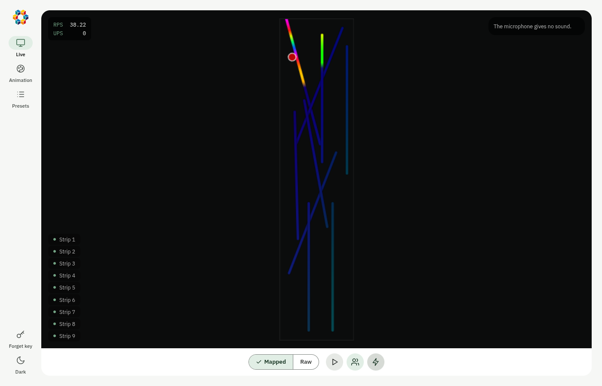
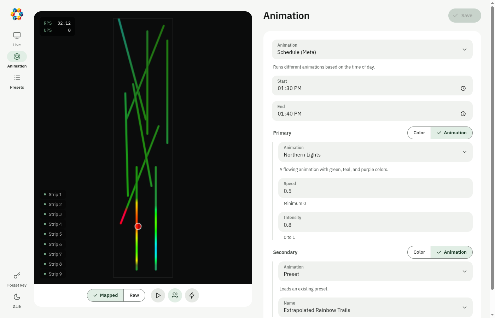
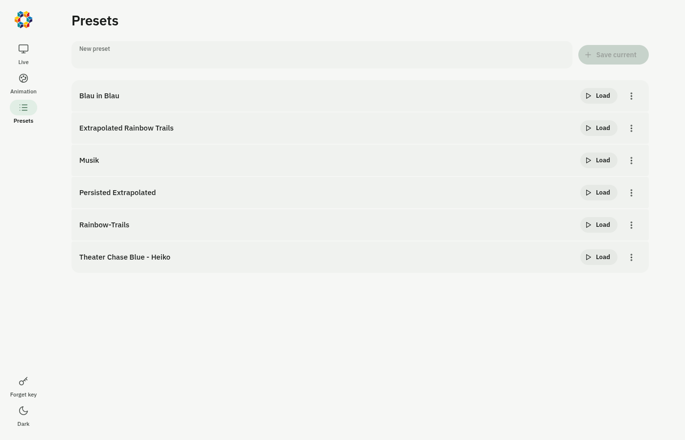

# Gangway Project

This project controls a lighting installation consisting of WS2805 LED strips using a Raspberry Pi 4B. It includes a custom driver implementation and a projection mapping system for complex visual effects that react to people walking through the area.

## Hardware Setup

The system is built around a Raspberry Pi 4B and a large array of LED strips suspended from the ceiling.

### Components
- **Controller**: Raspberry Pi 4B
- **Power System**:
  - Three 24V 300W Power Supplies
  - Step-Down Converter (24V to 5V) to power the Raspberry Pi
- **Lighting**: WS2805 LED strips
- **Mounting**: The strips are mounted on aluminum profiles, arranged in 3 groups of 3, each 2 meters long.
- **Sensor**: XOVIS PC2-L Person Counter

### Wiring and Connectivity
- **Data Signal**: The control signal originates from **GPIO 18** on the Raspberry Pi.
- **Signal Conditioning**: A level shifter is employed between the Raspberry Pi and the LED strips to convert the 3.3V logic to the required level for the LEDs.
- **Topology**: The strips are wired in a daisy-chain configuration.


## Person Detection & Data Flow

To enable interactive lighting effects, the system uses a **XOVIS PC2-L** person counter.

### Data Flow Pipeline
1.  **Acquisition**: The XOVIS sensor detects people in its field of view.
2.  **Push**: The sensor pushes event data (JSON) via HTTP POST to a lightweight web server running within the application (`XOVISServer`) on port 8081.
3.  **Processing**:
    *   The server parses the incoming JSON into event objects.
    *   **Projection Mapping**: Raw coordinates from the sensor are transformed using a homographic projection to match the physical floor plan. This ensures that a person standing at a specific location on the floor triggers the LED strip directly above them.
4.  **Distribution**: The processed coordinates are published to subscribers, primarily the `LEDController`, which updates the rendering state.

## Software

### Custom WS2805 Driver
This project uses a modified version of the `rp-ws281x` library to support the WS2805 protocol. The source code for this modified library can be found in the `rpi-ws2805-python` directory. The license has been updated to reflect these modifications.

### Configuration
The physical layout and logical mapping of the LEDs are defined in `config.yaml`. The system manages 9 distinct strip segments.

**Strip Layout:**

| Index | Length (LEDs) |
|-------|---------------|
| 1     | 24            |
| 25    | 24            |
| 49    | 23            |
| 71    | 24            |
| 97    | 24            |
| 121   | 24            |
| 145   | 24            |
| 169   | 24            |
| 193   | 24            |

The configuration also handles projection mapping parameters (`src_points`, `dst_points`) and defines cutout zones within the projection area.

## Animation System

The animation engine is designed to be procedural and responsive.

### How Animations Work
Animations are defined as Python functions that determine the color of a specific LED at a specific point in time.

*   **Input**:
    *   `time`: Current system time.
    *   `ctx`: Scene context (floor dimensions, LED positions).
    *   `led`: The specific LED being rendered.
    *   `objects`: A list of currently detected people (coordinates).
*   **Output**: An `RGBCCT` color value.

### Rendering Loop
The `LEDController` runs a continuous loop:
1.  It iterates through every LED in the system.
2.  It calls the active animation function for that LED.
3.  It updates the physical strip with the calculated colors.

### Interactive Animations
Responsive animations (e.g., `paint`, `dot`) utilize the `objects` list to calculate distance-based effects. For example, the `paint` animation maintains a history of positions to create trailing light effects that follow people as they move through the gangway.

### Recursive Composition & Meta-Animations

A powerful feature of the system is the ability to nest animations recursively. "Meta-animations" are animations that take other animations as input arguments instead of just colors.

**Benefits:**
*   **Modularity**: Complex behaviors can be built by combining simple building blocks. For example, `blend(rainbow(), sparkle())` creates a sparkly rainbow effect without writing a new dedicated function.
*   **Logic Abstraction**: Control logic is decoupled from visual logic.
    *   `schedule(day_anim, night_anim)`: Switches behavior based on time of day.
    *   `proximity(active_anim, idle_anim)`: Smoothly transitions between effects based on how close a person is to a specific point.
*   **Infinite Depth**: Since a meta-animation conforms to the standard animation interface, it can be wrapped in another meta-animation. You can have a `schedule` that switches between a `blend` and a `proximity` animation.

This functional approach allows for high flexibility and rapid experimentation with visual effects.

## User Interface

A frontend interface is provided to manage animations and settings.





## System (NixOS)

This repo is also a Nix flake. The flake describes the complete Raspberry Pi:
the operating system, the network, the services and the app. The board
support comes from [nixos-raspberrypi](https://github.com/nvmd/nixos-raspberrypi).

| Path | Content |
|------|---------|
| `flake.nix` | The inputs. All outputs come from `modules/`. |
| `modules/hosts/gangway.nix` | The host `gangway` and its SD image. |
| `modules/nixos/` | The system modules: network, WireGuard, services, app. |
| `nix/` | The packages: backend, web UI and LED driver. |
| `secrets/gangway.yaml` | The secrets, encrypted with sops. |

The admin account is `gangway`. `fsi` is an alias with the same UID, home
and SSH key, so `ssh fsi@gangway.local` also works.

### Network

| Interface | Address | Function |
|-----------|---------|----------|
| `eth0` | 10.0.0.1/24 | Private LAN for the Xovis sensor. dnsmasq gives DHCP leases from 10.0.0.2 to 10.0.0.254. |
| `wlan0` | DHCP | Uplink over "Iphone Hotspot" or "freeCampus". The Pi masquerades the sensor LAN through this link. |
| `beimgraben.net` | 10.66.66.200/24 | WireGuard tunnel to beimgraben.net. |
| `vpn.stupa` | 10.0.2.3/32 | WireGuard tunnel to vpn.reutlingen.university. |

| Port | Service | Reachable from |
|------|---------|----------------|
| 22 | SSH, key only | All interfaces |
| 80 | nginx: web UI, `/api/` and `/live` | All interfaces |
| 8081 | Xovis receiver | `eth0` and the tunnels |
| 8082 | API | `eth0` and the tunnels |

Set the push target of the Xovis sensor to `http://10.0.0.1:8081/`. The
receiver accepts bodies with `Content-Length` and chunked bodies.

The app keeps its run-time state in `/var/lib/gangway`: `config.yaml` and
`presets/`. Each start copies the `config.yaml` and the presets of this repo
into that directory, but only the files that are not there yet. The service
never overwrites a file, so the changes from the web UI stay.

The `config.yaml` and the presets in this repo come from the old SD card:
the projection points, the cutout, the strip layout and the active animation.
Two presets on the old card were corrupted and are lost: "Off-at-Night" and
"Secret-Rave-Rainbow-Trails".

### Secrets

`secrets/gangway.yaml` holds the WiFi passwords, the WireGuard keys and the
`API_KEY` of the web UI. sops encrypts the file for two recipients, see
`.sops.yaml`:

- The GPG key of the admin. Use it to edit the file.
- The age key of the Pi. sops-nix derives it from the SSH host key
  `/etc/ssh/ssh_host_ed25519_key` when the system activates.

To edit the secrets, do this step:

```sh
sops secrets/gangway.yaml
```

If the Pi gets a new SSH host key, do these steps:

1. Get the age key of the Pi: `ssh-keyscan -t ed25519 gangway.local | ssh-to-age`.
2. Replace the `gangway` key in `.sops.yaml` with this value.
3. Re-encrypt the file: `sops updatekeys secrets/gangway.yaml`.

### Install on a new SD card

The SD image contains no secrets and no SSH host key. You must copy the host
key onto the card before the first boot. If you do not do this, sops-nix
cannot decrypt the secrets, and the Pi has no WiFi and no tunnels.

1. Build the image: `nix build .#gangway.sd-image`.
2. Find the device of the card with `lsblk`, for example `/dev/sdX`.
3. Write the image. This erases the card:
   `sudo dd if=result/sd-image/*.img of=/dev/sdX bs=4M conv=fsync status=progress`.
4. Mount the root partition: `sudo mount /dev/sdX2 /mnt`.
5. Copy the host key:
   `sudo install -D -m 600 ssh_host_ed25519_key /mnt/etc/ssh/ssh_host_ed25519_key`.
6. Copy the public key:
   `sudo install -m 644 ssh_host_ed25519_key.pub /mnt/etc/ssh/ssh_host_ed25519_key.pub`.
7. Unmount the partition: `sudo umount /mnt`.
8. Put the card into the Pi and start the Pi.

On the first boot, the root partition grows to fill the card.

### Deploy a change

Build on your computer and activate on the Pi over SSH:

```sh
nixos-rebuild switch --flake .#gangway --target-host gangway@gangway.local --sudo
```

To build the system for aarch64 on an x86_64 computer, the computer must
emulate aarch64. On NixOS, set `boot.binfmt.emulatedSystems = [ "aarch64-linux" ];`.
The binary cache of nixos-raspberrypi holds the vendor kernel, so the kernel
does not compile under emulation.

## Development

`nix develop` opens a shell with Python 3.13, the dependencies of the app,
ruff, basedpyright, pytest and Node.js. The shell also creates `.venv`, so
your editor finds the same interpreter.

```sh
nix develop
ruff check . && ruff format --check .
basedpyright
python -m pytest
cd frontend && npm ci && npm run dev
```
